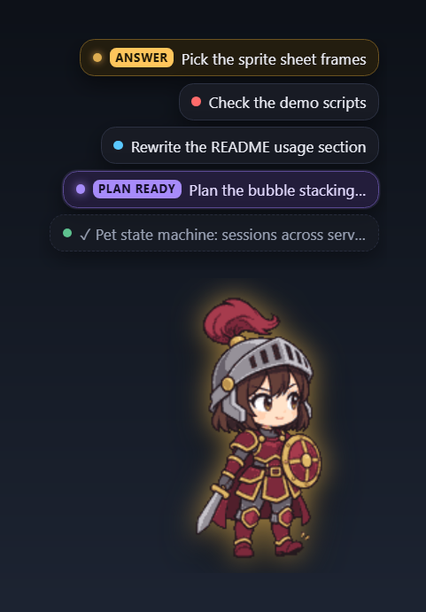

# cute-pets

Desktop pets for [OpenCode](https://opencode.ai) that show **real sessions** — titles,
states, approvals and chat — instead of a decorative bubble.



Codex Pets can do this because it *is* a client of its agent. So is cute-pets: it is a
client of OpenCode's own HTTP+SSE server, not an MCP sink. It knows your session titles,
which session is blocked on an approval, what the model just said, and it can type back
into any of them. No tokens spent, no hooks required.

```
          opencode serve ──HTTP+SSE──▶ brain ──HTTP+SSE──▶ faces
                 ▲                    (src/)               ├─ pet window     (sprite)
                 └── plugin announce ──┘                   ├─ bubbles window (bubble stack)
                                                           ├─ panel window   (sessions, chat)
                                                           └─ web tray / pet-only
```

- **brain** (`src/`, Node 22, zero runtime dependencies) — holds the OpenCode client,
  the state machine, the permission queue, and serves snapshots.
- **faces** (`electron/`, `faces/web/`) — three thin Electron windows (sprite, bubbles,
  panel) plus a browser session tray. All render the same
  `{pet, sessions, permissions}` snapshot.
- **plugin** (`plugin/cute-pets.ts`, optional) — tells the brain where a server lives.

---

## Install and run

Requirements: **Node ≥ 22**, the **opencode** CLI on `PATH`, and (for the pet window)
Electron, which is already a devDependency.

```bash
npm install
node node_modules/electron/install.js    # only if "Electron failed to install correctly"

npm run brain    # terminal 1 — brain on http://127.0.0.1:4280
npm run shell    # terminal 2 — the floating pet
```

The brain finds `opencode` servers by itself: it scans the listening ports of `opencode`
processes and probes `/global/health` (v1) or `/api/info` (v2). Start a TUI whenever you
like — new servers are picked up within ~10 seconds.

Browser faces, if you prefer: <http://127.0.0.1:4280> (session tray) and
<http://127.0.0.1:4280/min.html> (pet-only view).

### Five things to try first

1. **Click the pet** — the panel opens in its own window next to her; click again to close.
2. **Drag her** anywhere — across monitors or to the very top of the screen.
   Right-click the pet → **Move to display** to park her on another monitor.
   Double-click flips the sprite horizontally.
3. **`+`** opens a blank chat seeded from the session you are viewing — its directory,
   model (including effort) and agent. With no session selected it falls back to the last
   used values. Type `/cd /path` to change the directory, `/model` to pick a model,
   `/effort` to choose its reasoning effort, then send the first message.
4. **`/` in the composer** lists commands — agent ones (`/init`, `/review`) and pet ones
   (`/cd`, `/fork`, `/btw`, `/model`, `/effort`, `/agent`, `/plan`, `/build`, `/compact`, `/undo`,
   `/redo`, `/share`, `/abort`, `/pets`). Tab completes the highlighted command (or
   directory) into the composer so you can keep typing; Enter runs the selection. `/plan`
   and `/build` can carry the message to send after switching (`/build go`). After
   `/cd` the directory suggestions stay open and filter as you type (they are the
   current/last directory and every session's directory; type any other absolute path and
   press Enter).
5. **Right-click a session or bubble → Hide from pet** to clear finished work out of the
   way. Nothing is deleted: the session stays in OpenCode and in the sessions column; use
   the `shown / hidden / all` visibility filter there (or the chat header's *show in pet*)
   to bring it back.

---

## What it does

**Sessions** — every session with its real title, project directory, agent, model and
token/cost totals, deduplicated across the several `opencode serve` processes that can
share one database. Sessions that need you come first, then failed ones, then running ones.
Within a priority, active sessions follow the last user request (most recent first): a
prompt is a discrete event, so a running session never jumps around just because it emitted
a token. Idle sessions are ordered by their last meaningful update — the end of the last
turn, an edit, or a rename (most recent first) — so recent work stays findable. The list
loads OpenCode's newest 50-session
page; the true all-time totals come from `/api/experimental/session/stats`, so the counters
in the header, sessions footer, tray and Settings include sessions outside that page without
loading them all.

**Forking** — `/fork` opens a picker with **Full session** and the newest user messages.
Choosing a message forks before it and opens the child with that prompt already in the
composer; choosing **Full session** copies the whole conversation. The inline **fork**
button on any user message does the same at that point, and right-click a session → Fork
copies the full history. The child is selected, keeps the parent's title with `(fork #N)`,
and appears immediately instead of as `(untitled)`.

**Editing earlier turns** — every user message has **edit**, **fork** and **copy** buttons.
Edit stages OpenCode's revert boundary at that message, puts its text back into the
composer, and shows a `revert staged · redo` strip. Sending commits the revert and replaces
everything from that point on; **redo** restores the original history. Attachments and
images are not restored. On v2, `/undo` and `/redo` use the same stage/clear flow; they were
previously unimplemented.

**Side questions (`/btw`)** — `/btw <question>` asks a one-shot question against the
selected session's context using OpenCode 2's transient generate endpoint. It runs in the
background: the small speech-bubble button in the chat header shows a running dot, and the
modal with the markdown answer and copy button opens by itself when the answer is ready —
including when the dialog was closed while the question was still running. It never becomes
a chat message, changes the session state, or calls tools. Bare `/btw` opens the same dialog
with a question input. The last question/answer is kept per session while the app runs, so
closing the dialog does not lose it; the header button reopens it, with a dot while a
question is running, an answer is unread, or it failed. An answer that arrives while you are
on another session stays as that session's dot instead of opening over the current chat. v1
servers report that side questions need OpenCode 2.

**States** — `running`, `waiting` (an approval or an agent question is pending), `error`,
`idle`, rolled up per pet with the urgent one winning. Bubbles float above the sprite for
the sessions that need attention. A waiting bubble carries an **answer** or **approve**
badge and a pulsing amber dot, so a pending question is visible without opening the panel;
hovering shows its title, directory, what it is waiting for, the question/permission and
the tail of the last message.

**Plan mode** — `/plan` switches the selected session (or the draft) to OpenCode's
read-only `plan` agent. The pet turns violet, uses the spritesheet's review row (row 8)
with a violet aura. A question asked while planning still shows the amber **answer** badge
and pulse, so the violet mode never hides that the agent is blocked on you. When a plan
finishes it keeps a violet **plan ready** bubble in the answer style — solid, badged and
glowing instead of the normal ✓ — and it stays until you implement or hide it rather than
falling off with the finished bubbles. Readiness comes from the last completed assistant
message's agent, so a plan that finished before a brain restart is reconstructed from
OpenCode's history. An open chat shows a violet **plan ready** strip
above the composer with a small **implement** button.
That button switches the session to build and sends `Implement the plan.` in one action —
the same hand-off as `/build Implement the plan.`, so read the plan, then click once.
`/build` switches back. Both commands also accept the message to send
after switching, so `/build go` switches and sends `go` in one action; `/build` alone
only switches and the next message starts the work. A pack that has no review pose simply
keeps its idle frame; the violet aura still marks the mode.

**Questions (v2 forms)** — when the agent asks via OpenCode 2's form API, the session
becomes `waiting` and a compact form card appears above the composer. It supports text,
number/integer, boolean, multiselect and option strings, conditional fields (`when`),
required fields and external-link acknowledgements. Answers are posted back to the
session through the brain, the form disappears and the session resumes.

**Finished work stays visible.** When a session ends while the pet is running it keeps a
dashed bubble with a ✓ (the two most recent, newest nearest the pet), so you can see what
just completed and open it — it leaves the pet only when you hide it, and a restart seeds
the bubbles with anything that finished in the last 15 minutes. A new bubble is appended to
the stack rather than pushing the others down, so the one you were about to click stays put.

**Approvals** — permission requests are rendered as buttons: *once*, *always*, *reject*.
Answered from the pet, the TUI never has to be found.

**Chat** — type into any session from the panel, or start a new one. `+` opens a blank
chat seeded from the session you are viewing (or the last used values); `/cd` validates
and sets the directory (on v2 it moves an existing session), and `/model` / `/effort` /
`/agent` work in the draft as well as on a session. The first message creates the session
at the chosen location with the chosen model and effort — no folder picker, no untitled
session left behind. The composer is a five-row textarea. By default **Ctrl/Cmd+Enter**
sends and Enter adds a newline; Settings → Send message can switch to **Enter sends,
Shift+Enter adds a newline**. While a turn is running, a normal send **steers** into
that turn (OpenCode's default); `/queue <message>` waits for the current turn to finish,
and **Ctrl/Cmd+Shift+Enter** does the same for the composer text. `/steer <message>`
forces the opposite. Queued messages appear in a strip above the composer, where they can
be cancelled or promoted with **send now**; the queue is OpenCode's own durable inbox, so
it survives restarts and stays in sync with the TUI. Typed-but-unsent text is kept per
session and restored when you switch back. The **☰** button in the panel header
(**Ctrl/Cmd+B**) hides the sessions column so the chat fills the whole panel. While it is
hidden, a round activity badge shows how many sessions are running, waiting, errored or
plan-ready; hover or click it for a compact list and select one directly. OpenCode 2
hosts sessions at arbitrary locations on one server; v1 keeps the old server-per-directory
spawn. Messages render markdown:
headings, lists, tables, links, inline code, and fenced code blocks with a language label
and a copy button. Every user/assistant message with text also has a **copy** button
(raw markdown) and selectable text. Rendering is local and dependency-free, and everything
is HTML-escaped before markup is added.

The chat opens at the newest message (normal chronological order, scrolled to the bottom);
after reading back, a small **↓** button returns to the latest. Long sessions start with
the **first user message** pinned at the top; **Load earlier** pages the omitted history
in without losing your scroll position. Consecutive assistant steps that only contain
thinking/tool calls are grouped into one collapsed trace
(`15 steps · 17 tools · 15 thinking`) per turn, expandable to the individual calls with
their input/output. While a session is running, the last trace shows a live line such as
`● thinking · …` or `● shell · running · …`. Provider errors stay visible as a compact
line: muted for aborted steps and for errors that were retried and followed by another
assistant step, red only when the turn actually failed.

**New chat** — a blank chat seeded from the session you are viewing: directory, model
(including its effort variant) and agent. The header shows `provider/model#variant`
so two providers exposing the same model ID stay distinguishable; hovering a clipped
title or meta label reveals its full text. With nothing selected it
falls back to the last used values. `Ctrl+N` and the pet's right-click *New chat* reach the
same thing. `/cd`, `/model` and `/effort` apply to the draft until the first message creates
the session.

**Effort** — `/effort` lists the current model's catalog variants (`low`, `high`, `max`, …)
plus `default` to reset. Models without variants show a short notice instead of an empty
list. The active variant appears as `#variant` in the header and is carried into the next
new chat.

**Pet packs** — Codex/OpenPets-compatible spritesheets (192×208 cells, 8 columns). A
red-armoured chibi knight ships in the repo and is installed by default; any `.zip` or
folder can be imported, switched at runtime and mirrored.

**Placement** — three windows: a fixed-size sprite window, a bubble window sized to the
stack, and the panel window. Dragging clamps the *sprite* to the virtual desktop, so she
crosses monitor seams smoothly and can be parked against any edge. The position is saved
in `petPosition` and restored on the next launch; if a monitor is unplugged, the pet is
clamped back onto a remaining display. Right-click → **Move to display** parks her at the
bottom-right of a chosen monitor.

The pet window never resizes: bubbles and the panel live in their own always-on-top
windows. A bubble appearing/disappearing, or the panel opening, therefore cannot move the
sprite — the bubble window changes size on its own, hugging the stack and following her,
and the panel window is sized to the room above the sprite (574 px when there is space,
less when there is not) or placed below her when there is none. The panel is 560 px wide by
default; drag any edge to resize one dimension, or any corner to resize both at once. Growing
toward the pet pushes it along with the same gap instead of covering it; the pet is clamped to
the work area, so the panel stops growing once the pet reaches the screen edge. The chosen
width, height and any pushed pet position are saved in `~/.cute-pets/config.json`. The new-chat
popover (`+`) is a short panel window. Context menus are native menus, and the tooltip is
drawn in the pet window (pointer-transparent) on behalf of the bubble window.

**Hidden sessions** — pet-side only: the session keeps existing (and running) in OpenCode,
but stops appearing in the pet's bubbles, aura and counts. It remains in the sessions
column: the visibility filter defaults to `shown` and offers `hidden` and `all`; hidden
rows are dimmed and carry an eye-off icon. Right-click one → **Show in pet**, or use the
chat header's **show in pet** for the selected session. Persisted in
`~/.cute-pets/hidden.json`. The activity badge ignores pet-hidden sessions, so expand the
sessions column (`Ctrl/Cmd+B`) to reach them when it is collapsed.

---

## Pet packs

### The built-in pet

The repo ships one pack, `pets/chibi-knight/` — an original red-armoured chibi knight,
8 columns × 11 rows of 192×208 cells. It was generated for this project, so a default
install has a pet that belongs to it rather than borrowing a character from a game.

On first run the brain copies it into `~/.cute-pets/pets/` and makes it the active pet
if you have not chosen one; `GET /api/pet` serves it straight from the repo even before
that copy exists. Importing any other pack simply takes over as the active choice — the
built-in one stays in the list, and deleting `~/.cute-pets/pets/chibi-knight` brings it
back on the next start.

```bash
npm run pets -- list                         # installed pets, * = active
npm run pets -- import brawl-worker          # by Codex pet id (~/.codex/pets/<id>)
npm run pets -- import C:/path/pack.zip      # a .zip or a directory
npm run pets -- use saber                    # switch
```

A pack is a directory with `pet.json` and a spritesheet:

```json
{
  "id": "saber",
  "displayName": "Saber",
  "description": "A watchful Saber companion in blue and silver armor.",
  "spriteVersionNumber": 2,
  "spritesheetPath": "spritesheet.webp"
}
```

Cells are 192×208, 8 columns; rows map to the pet's animations. Codex V2 packs use the
standard layout (`0 idle`, `2 running-left`, `5 failed`, `6 waiting`, `8 review`). A pack
whose sheet differs can declare its own map in `pet.json`:

```json
"rows": { "idle": 0, "running": 2, "waiting": 6, "error": 9, "plan": 8 }
```

The built-in chibi-knight does this because it repurposes row 9 as its error pose and has
no separate review pose. Without `rows`, the standard defaults are used. Packs live in
`~/.cute-pets/pets/<id>/`, and the active one is `activePet` in the config.

---

## Connecting servers

Local processes are discovered automatically. Anything else can be attached:

```bash
curl -X POST http://127.0.0.1:4280/api/attach -d '{"url":"http://localhost:4096"}'
curl -X POST http://127.0.0.1:4280/api/detach -d '{"url":"http://localhost:4096"}'
```

Attached URLs are saved under `servers` in `~/.cute-pets/config.json` and re-attached at
start. WSL2 forwards `localhost`, so a server started inside WSL as
`opencode serve --hostname 0.0.0.0 --port 4096` is reachable from Windows at
`http://localhost:4096`.

**OpenCode 2 in WSL needs no setup at all.** A managed v2 service publishes its own
credentials to `~/.local/state/opencode/service.json` (`url` + `password`). The brain reads
that file through `\\wsl.localhost\<distro>\home\<user>`, rewrites the loopback address to
`localhost` (WSL2 forwards it), and attaches with the password it found — no copy-paste:

```
attached WSL service http://localhost:49374 (Ubuntu-26.04)
```

That is the path the OpenCode desktop app / `opencode serve --service` uses, and it is
re-checked every 10 s (a stale entry is retried at most once a minute). Nothing is written to
your OpenCode files and the password is only kept in `~/.cute-pets/config.json`, like any
other attached server.

For a server you start by hand, pass the password instead:

```bash
# in WSL
OPENCODE_SERVER_PASSWORD=… ~/.opencode/bin/opencode serve --hostname 0.0.0.0 --port 4301

# once, from Windows - stored and reused on every start
curl -X POST http://127.0.0.1:4280/api/attach \
  -d '{"url":"http://localhost:4301","password":"…"}'
```

or `npm run brain -- --server http://localhost:4301 --password …`.

**Pick a model v2 knows.** v1 model ids (`deepseek-v4.1-flash-free` and friends) may not exist
on a v2 server; if you send one, the run sits in `running` while the server retries
(`session.retry.scheduled`) and never produces text. List what the server has with
`GET /api/model` (e.g. `gemini-4-carbon`) and use that id.

v2 differences the client already absorbs: a normal send uses `delivery:"queue"` on an
idle session and `delivery:"steer"` while a turn is running or a mode reminder is pending;
`/queue` forces queue. The durable inbox is read with `GET /api/session/{id}/inbox`,
cancelled with
`DELETE /api/session/{id}/inbox/{inboxID}` and promoted with
`PATCH /api/session/{id}/inbox/{inboxID}`. Messages are newest-first with `content[]`
instead of `parts[]` and user text at `m.text`, permission replies use
`{action, resources}`, `/fork` is wired (`POST /api/session/{id}/fork`; it accepts
`before: messageID` and the `session.forked` event is translated into a session fetch so
the child's "… (fork #N)" title shows at once), `/model`/`/agent` use the v2 session
routes, `/cd` uses `POST /api/session/{id}/move`, undo/redo use
`revert/stage` + `revert/commit` / `DELETE revert`, aggregate totals use
`/api/experimental/session/stats?tools=none`, `/btw` uses
`POST /api/session/{id}/generate` for transient context-only answers, and `/compact`/`/share`
are **not wired for v2**.

---

## Configuration and files

| Path | What |
| --- | --- |
| `~/.cute-pets/config.json` | `facing`, `auras`, `sendWith`, `activePet`, attached `servers` (with credentials), `lastDirectory`, `lastModel`, `lastAgent`, `petPosition` |
| `pets/<id>/` (repo) | packs that ship with cute-pets: `chibi-knight` |
| `~/.cute-pets/pets/<id>/` | installed pet packs (the built-in one is copied here on first run) |
| `~/.cute-pets/hidden.json` | sessions hidden from the pet |
| `~/.cute-pets/brain.json` | written by a running brain |
| `~/.cute-pets/brain.log` | brain log (same lines as stdout) |

Facing is a config value, never inferred from screen position:

```json
{ "facing": "left" }
```

`right` (default) is the sprite as authored, `left` is mirrored. Override per launch with
`npm run shell -- --facing left`.

Auras are on by default: idle is green, running blue, waiting amber, error red, and plan
violet. Turn them all off with Settings → Auras or `{ "auras": false }` in the config.

`sendWith` is `"ctrl-enter"` (default) or `"enter"`; the same choice is in
Settings → Send message.

Settings → UI scale offers 90/100/110/125/150% for the panel, bubble titles/badges and
tooltips. It is a renderer-local preference (`localStorage`), not `config.json`; the pet
sprite stays fixed and the browser tray uses browser zoom. At larger scales the panel can be
resized for more room.

The pet remembers where it was left as `petPosition` (screen coordinates). It is restored
only if that spot still overlaps a display; otherwise the pet is clamped back on-screen.

---

## Brain API

Everything a face needs, all JSON:

```
GET  /api/state            {pet, stats, sessions[], permissions[], forms[], servers[], hidden[]}
                             `stats` is the all-time aggregate from OpenCode:
                             {sessions, subagents, prompts, steps, tokens, cost, range}
                             sessions carry `queued[]` (undelivered v2 inbox messages) and
                             `petHidden`; every session is returned, hidden ones are only
                             excluded from `pet`
GET  /api/events           SSE stream of the same snapshot
GET  /api/health           {ok, uptime}
GET  /api/pet  /api/pets   active pet + installed packs
POST /api/pets/import      {path}            .zip or folder
POST /api/pets/active      {id}
GET  /api/commands         agent commands from OpenCode (init, review, …)
GET  /api/models  /api/agents  /api/workspaces
                             models carry providerID and variants[] (effort levels)
GET  /api/defaults         {directory, server, model, agent}   fallback for a blank chat
POST /api/checkdir         {directory, server?}  validate a path (v2; WSL-aware)
POST /api/prompt           {text, sessionId?|newSession, directory?, server?, model?, agent?, delivery?}
                             delivery: steer|queue (queue = wait for the current turn)
GET  /api/messages         ?server=&sessionId=&limit=
GET  /api/message-page     ?server=&sessionId=&limit=&order=&type=&cursor=&compact=1
POST /api/inbox/cancel     {server, sessionId, inboxId}   cancel an undelivered message
POST /api/inbox/steer      {server, sessionId, inboxId}   promote queue → steer
POST /api/permission       {id, reply: once|always|reject}
POST /api/form             {server, sessionId, formId, answer}   answer a v2 agent question
POST /api/abort            {server, sessionId}
POST /api/session/hide     {sessionId, hidden:true|false}
POST /api/session/action   {sessionId, action: move|fork|btw|revert|undo|redo|compact|share|model|agent, …}
                           fork takes value:{before: messageID}; omit it for the full session
                           btw takes value:{text} and returns {text} from the session context
POST /api/attach  /api/detach  /api/announce
POST /api/session/close    {server, sessionId}   — deletes in OpenCode, no UI uses it
```

---

## Limitations

- OpenCode 2: compact and share are v1-only; fork (including `before`), model/agent switch,
  moving a session between directories (`/cd`), and undo/redo (stage/clear) work on v2.
- `/btw` needs OpenCode 2's transient generate endpoint; on v1 it reports that side
  questions need OpenCode 2.
- `/cd` cannot move a v1 session (the v1 server is bound to one directory); start a
  new chat there instead.
- The chat loads the last 30 messages only; older history is not paged in yet.
- Permission replies on v2 use `{action, resources}`; that path has not been exercised
  against a live request.
- The pet, bubbles and panel are separate windows. The pet window is fixed and never
  resizes; the bubble window is sized to the stack and the panel window to the room
  available on screen.
- Linux/macOS: the Electron shell is portable, but only Windows has been run in anger;
  window stacking and work-area clamping are the platform-specific parts.

## Development

```bash
npm run smoke        # hermetic end-to-end: fake OpenCode + brain, no provider
npm run smoke:live   # live: real OpenCode + model (spends credits)
npm test             # state-machine unit tests
```

`npm run fake -- --port 4096` starts the fake OpenCode server on its own; point the
brain at it with `npm run brain -- --server http://127.0.0.1:4096 --no-discover` to
click through sessions offline.

`npm run smoke:live` uses the attached server's default model. Set
`CUTE_PETS_SMOKE_MODEL=provider/model` to pin one (for example
`opencode-go/deepseek-v4.1-flash`) and avoid the pay-as-you-go default.

`npm run shell -- --dev` exposes a control server on `:4290`: `/size`, `/eval?js=…` and
`/shot?file=…` drive the pet window; `/bubble-…` and `/panel-…` do the same for the
bubbles and panel windows.

```
src/main.mjs        hub: discovery, attach, dispatch, hidden persistence
src/opencode.mjs    v1 client        src/opencode-v2.mjs  v2 client (auth, /api/*, events)
src/state.mjs       session/state machine, permissions, snapshots
src/server.mjs      face API + SSE      src/pets.mjs  pet store + built-in seeding
src/config.mjs      ~/.cute-pets/config.json
pets/chibi-knight/  the pack that ships with the repo
electron/main.cjs   pet + panel windows, placement, menus, drag
electron/sizes.cjs  window sizes shared by the shell and the face
faces/web/min.html  the pet window UI   faces/web/index.html  full tray
```

`SPEC.md` holds the verified OpenCode surface, the state mapping and the cross-platform
notes.
