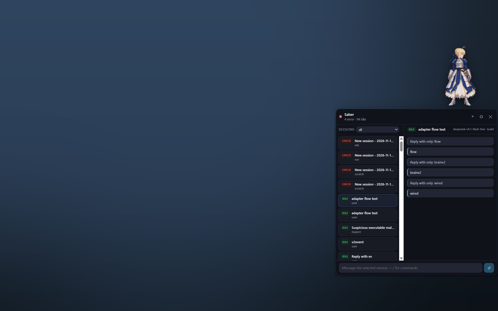

# cute-pets

Desktop pets for [OpenCode](https://opencode.ai) that show **real sessions** — titles,
states, approvals and chat — instead of a decorative bubble.



Codex Pets can do this because it *is* a client of its agent. So is cute-pets: it is a
client of OpenCode's own HTTP+SSE server, not an MCP sink. It knows your session titles,
which session is blocked on an approval, what the model just said, and it can type back
into any of them. No tokens spent, no hooks required.

```
          opencode serve ──HTTP+SSE──▶ brain ──HTTP+SSE──▶ faces
                 ▲                    (src/)               ├─ pet window     (sprite)
                 └── plugin announce ──┘                   ├─ bubbles window (bubble stack)
                                                           ├─ panel window   (sessions, chat)
                                                           └─ web tray / pet-only
```

- **brain** (`src/`, Node 22, zero runtime dependencies) — holds the OpenCode client,
  the state machine, the permission queue, and serves snapshots.
- **faces** (`electron/`, `faces/web/`) — three thin Electron windows (sprite, bubbles,
  panel) plus a browser session tray. All render the same
  `{pet, sessions, permissions}` snapshot.
- **plugin** (`plugin/cute-pets.ts`, optional) — tells the brain where a server lives.

---

## Install and run

Requirements: **Node ≥ 22**, the **opencode** CLI on `PATH`, and (for the pet window)
Electron, which is already a devDependency.

```bash
npm install
node node_modules/electron/install.js    # only if "Electron failed to install correctly"

npm run brain    # terminal 1 — brain on http://127.0.0.1:4280
npm run shell    # terminal 2 — the floating pet
```

The brain finds `opencode` servers by itself: it scans the listening ports of `opencode`
processes and probes `/global/health` (v1) or `/api/info` (v2). Start a TUI whenever you
like — new servers are picked up within ~10 seconds.

Browser faces, if you prefer: <http://127.0.0.1:4280> (session tray) and
<http://127.0.0.1:4280/min.html> (pet-only view).

### Five things to try first

1. **Click the pet** — the panel opens in its own window next to her; click again to close.
2. **Drag her** anywhere — across monitors or to the very top of the screen.
   Right-click the pet → **Move to display** to park her on another monitor.
   Double-click flips the sprite horizontally.
3. **`+`** opens a blank chat in the last used directory (or the server's default).
   Type `/cd /path` to change it, `/model` to pick a model, then send the first message.
4. **`/` in the composer** lists commands — agent ones (`/init`, `/review`) and pet ones
   (`/cd`, `/fork`, `/model`, `/agent`, `/plan`, `/build`, `/compact`, `/undo`, `/redo`,
   `/share`, `/abort`, `/pets`). Tab completes the highlighted command (or directory) into
   the composer so you can keep typing; Enter runs the selection. After `/cd` the directory
   suggestions stay open and filter as you type (they are the current/last directory and
   every session's directory; type any other absolute path and press Enter).
5. **Right-click a session or bubble → Hide from pet** to clear finished work out of the
   way. Nothing is deleted; Settings has an *unhide* list.

---

## What it does

**Sessions** — every session with its real title, project directory, agent, model and
token/cost totals, deduplicated across the several `opencode serve` processes that can
share one database.

**Forking** — `/fork` (or right-click a session → Fork) forks the selected session at its
latest message through the server's own fork endpoint. The child is selected, keeps the
parent's title with `(fork #N)`, and appears immediately instead of as `(untitled)`.

**States** — `running`, `waiting` (an approval or an agent question is pending), `error`,
`idle`, rolled up per pet with the urgent one winning. Bubbles float above the sprite for
the sessions that need attention; hovering one shows its title, directory, state and the
tail of the last message.

**Plan mode** — `/plan` switches the selected session (or the draft) to OpenCode's
read-only `plan` agent. The pet turns violet, uses the spritesheet's review row (row 8)
with a violet aura, and the session/bubble gets a ✦ marker. When a plan finishes it keeps
a violet **✦ plan ready** bubble instead of the normal ✓. `/build` switches back. A pack
that has no review pose simply keeps its idle frame; the violet aura still marks the mode.

**Questions (v2 forms)** — when the agent asks via OpenCode 2's form API, the session
becomes `waiting` and a compact form card appears above the composer. It supports text,
number/integer, boolean, multiselect and option strings, conditional fields (`when`),
required fields and external-link acknowledgements. Answers are posted back to the
session through the brain, the form disappears and the session resumes.

**Finished work stays visible.** When a session ends while the pet is running it keeps a
dashed bubble with a ✓ (up to four, newest first), so you can see what just completed and
open it — it leaves the pet only when you hide it, and a restart seeds the bubbles with
anything that finished in the last 15 minutes.

**Approvals** — permission requests are rendered as buttons: *once*, *always*, *reject*.
Answered from the pet, the TUI never has to be found.

**Chat** — type into any session from the panel, or start a new one. `+` opens a blank
chat; `/cd` validates and sets the directory (on v2 it moves an existing session), and
`/model` / `/agent` work in the draft as well as on a session. The first message creates
the session at the chosen location with the chosen model — no folder picker, no untitled
session left behind. OpenCode 2 hosts sessions at arbitrary locations on one server; v1
keeps the old server-per-directory spawn. Messages render markdown:
headings, lists, tables, links, inline code, and fenced code blocks with a language label
and a copy button. Rendering is local and dependency-free, and everything is HTML-escaped
before markup is added.

The chat opens at the newest message (normal chronological order, scrolled to the bottom);
after reading back, a small **↓** button returns to the latest. Consecutive assistant
steps that only contain thinking/tool calls are grouped into one collapsed trace
(`15 steps · 17 tools · 15 thinking`) per turn, expandable to the individual calls with
their input/output. Provider errors stay visible as a compact line: muted for aborted
steps and for errors that were retried and followed by another assistant step, red only
when the turn actually failed.

**New chat** — a blank chat with the last directory and model shown in the header. `Ctrl+N`
and the pet's right-click *New chat* reach the same thing. `/cd` and `/model` apply to the
draft until the first message creates the session.

**Pet packs** — Codex/OpenPets-compatible spritesheets (192×208 cells, 8 columns). A
red-armoured chibi knight ships in the repo and is installed by default; any `.zip` or
folder can be imported, switched at runtime and mirrored.

**Placement** — three windows: a fixed-size sprite window, a bubble window sized to the
stack, and the panel window. Dragging clamps the *sprite* to the virtual desktop, so she
crosses monitor seams smoothly and can be parked against any edge. The position is saved
in `petPosition` and restored on the next launch; if a monitor is unplugged, the pet is
clamped back onto a remaining display. Right-click → **Move to display** parks her at the
bottom-right of a chosen monitor.

The pet window never resizes: bubbles and the panel live in their own always-on-top
windows. A bubble appearing/disappearing, or the panel opening, therefore cannot move the
sprite — the bubble window changes size on its own, hugging the stack and following her,
and the panel window is sized to the room above the sprite (574 px when there is space,
less when there is not) or placed below her when there is none. The new-chat popover (`+`)
is a short panel window. Context menus are native menus, and the tooltip is drawn in the
pet window (pointer-transparent) on behalf of the bubble window.

**Hidden sessions** — pet-side only: the session keeps existing (and running) in OpenCode,
it just stops appearing on the pet. Persisted in `~/.cute-pets/hidden.json`, restorable from
*Settings → Hidden from pet*.

---

## Pet packs

### The built-in pet

The repo ships one pack, `pets/chibi-knight/` — an original red-armoured chibi knight,
8 columns × 11 rows of 192×208 cells. It was generated for this project, so a default
install has a pet that belongs to it rather than borrowing a character from a game.

On first run the brain copies it into `~/.cute-pets/pets/` and makes it the active pet
if you have not chosen one; `GET /api/pet` serves it straight from the repo even before
that copy exists. Importing any other pack simply takes over as the active choice — the
built-in one stays in the list, and deleting `~/.cute-pets/pets/chibi-knight` brings it
back on the next start.

```bash
npm run pets -- list                         # installed pets, * = active
npm run pets -- import brawl-worker          # by Codex pet id (~/.codex/pets/<id>)
npm run pets -- import C:/path/pack.zip      # a .zip or a directory
npm run pets -- use saber                    # switch
```

A pack is a directory with `pet.json` and a spritesheet:

```json
{
  "id": "saber",
  "displayName": "Saber",
  "description": "A watchful Saber companion in blue and silver armor.",
  "spriteVersionNumber": 2,
  "spritesheetPath": "spritesheet.webp"
}
```

Cells are 192×208, 8 columns; rows map to the pet's animations. Codex V2 packs use the
standard layout (`0 idle`, `2 running-left`, `5 failed`, `6 waiting`, `8 review`). A pack
whose sheet differs can declare its own map in `pet.json`:

```json
"rows": { "idle": 0, "running": 2, "waiting": 6, "error": 9, "plan": 8 }
```

The built-in chibi-knight does this because it repurposes row 9 as its error pose and has
no separate review pose. Without `rows`, the standard defaults are used. Packs live in
`~/.cute-pets/pets/<id>/`, and the active one is `activePet` in the config.

---

## Connecting servers

Local processes are discovered automatically. Anything else can be attached:

```bash
curl -X POST http://127.0.0.1:4280/api/attach -d '{"url":"http://localhost:4096"}'
curl -X POST http://127.0.0.1:4280/api/detach -d '{"url":"http://localhost:4096"}'
```

Attached URLs are saved under `servers` in `~/.cute-pets/config.json` and re-attached at
start. WSL2 forwards `localhost`, so a server started inside WSL as
`opencode serve --hostname 0.0.0.0 --port 4096` is reachable from Windows at
`http://localhost:4096`.

**OpenCode 2 in WSL needs no setup at all.** A managed v2 service publishes its own
credentials to `~/.local/state/opencode/service.json` (`url` + `password`). The brain reads
that file through `\\wsl.localhost\<distro>\home\<user>`, rewrites the loopback address to
`localhost` (WSL2 forwards it), and attaches with the password it found — no copy-paste:

```
attached WSL service http://localhost:49374 (Ubuntu-26.04)
```

That is the path the OpenCode desktop app / `opencode serve --service` uses, and it is
re-checked every 10 s (a stale entry is retried at most once a minute). Nothing is written to
your OpenCode files and the password is only kept in `~/.cute-pets/config.json`, like any
other attached server.

For a server you start by hand, pass the password instead:

```bash
# in WSL
OPENCODE_SERVER_PASSWORD=… ~/.opencode/bin/opencode serve --hostname 0.0.0.0 --port 4301

# once, from Windows - stored and reused on every start
curl -X POST http://127.0.0.1:4280/api/attach \
  -d '{"url":"http://localhost:4301","password":"…"}'
```

or `npm run brain -- --server http://localhost:4301 --password …`.

**Pick a model v2 knows.** v1 model ids (`deepseek-v4.1-flash-free` and friends) may not exist
on a v2 server; if you send one, the run sits in `running` while the server retries
(`session.retry.scheduled`) and never produces text. List what the server has with
`GET /api/model` (e.g. `gemini-4-carbon`) and use that id.

v2 differences the client already absorbs: prompts go out with `delivery: "queue"` (the
default `steer` is dropped when no turn is running), messages are newest-first with
`content[]` instead of `parts[]` and user text at `m.text`, permission replies use
`{action, resources}`, `/fork` is wired (`POST /api/session/{id}/fork`; the
`session.forked` event is translated into a session fetch so the child's
"… (fork #N)" title shows at once), `/model`/`/agent` use the v2 session routes,
`/cd` uses `POST /api/session/{id}/move`, and `/compact`, `/share`, `/undo`, `/redo`
are **not wired for v2**.

---

## Configuration and files

| Path | What |
| --- | --- |
| `~/.cute-pets/config.json` | `facing`, `activePet`, attached `servers` (with credentials), `lastDirectory`, `lastModel`, `lastAgent`, `petPosition` |
| `pets/<id>/` (repo) | packs that ship with cute-pets: `chibi-knight` |
| `~/.cute-pets/pets/<id>/` | installed pet packs (the built-in one is copied here on first run) |
| `~/.cute-pets/hidden.json` | sessions hidden from the pet |
| `~/.cute-pets/brain.json` | written by a running brain |
| `~/.cute-pets/brain.log` | brain log (same lines as stdout) |

Facing is a config value, never inferred from screen position:

```json
{ "facing": "left" }
```

`right` (default) is the sprite as authored, `left` is mirrored. Override per launch with
`npm run shell -- --facing left`.

The pet remembers where it was left as `petPosition` (screen coordinates). It is restored
only if that spot still overlaps a display; otherwise the pet is clamped back on-screen.

---

## Brain API

Everything a face needs, all JSON:

```
GET  /api/state            {pet, sessions[], permissions[], forms[], servers[], hidden[]}
GET  /api/events           SSE stream of the same snapshot
GET  /api/health           {ok, uptime}
GET  /api/pet  /api/pets   active pet + installed packs
POST /api/pets/import      {path}            .zip or folder
POST /api/pets/active      {id}
GET  /api/commands         agent commands from OpenCode (init, review, …)
GET  /api/models  /api/agents  /api/workspaces
GET  /api/defaults         {directory, server, model, agent}   last used / server default
POST /api/checkdir         {directory, server?}  validate a path (v2; WSL-aware)
POST /api/prompt           {text, sessionId?|newSession, directory?, server?, model?, agent?}
GET  /api/messages         ?server=&sessionId=&limit=
POST /api/permission       {id, reply: once|always|reject}
POST /api/form             {server, sessionId, formId, answer}   answer a v2 agent question
POST /api/abort            {server, sessionId}
POST /api/session/hide     {sessionId, hidden:true|false}
POST /api/session/action   {sessionId, action: move|fork|compact|undo|redo|share|model|agent, …}
POST /api/attach  /api/detach  /api/announce
POST /api/session/close    {server, sessionId}   — deletes in OpenCode, no UI uses it
```

---

## Limitations

- OpenCode 2: compact, share, undo/redo are v1-only; fork, model/agent switch and
  moving a session between directories (`/cd`) work on v2.
- `/cd` cannot move a v1 session (the v1 server is bound to one directory); start a
  new chat there instead.
- The chat loads the last 30 messages only; older history is not paged in yet.
- Permission replies on v2 use `{action, resources}`; that path has not been exercised
  against a live request.
- The pet, bubbles and panel are separate windows. The pet window is fixed and never
  resizes; the bubble window is sized to the stack and the panel window to the room
  available on screen.
- Linux/macOS: the Electron shell is portable, but only Windows has been run in anger;
  window stacking and work-area clamping are the platform-specific parts.

## Development

```bash
npm run smoke        # end-to-end: attach, create a session, prompt, read the reply
```

`npm run shell -- --dev` exposes a control server on `:4290`: `/size`, `/eval?js=…` and
`/shot?file=…` drive the pet window; `/bubble-…` and `/panel-…` do the same for the
bubbles and panel windows.

```
src/main.mjs        hub: discovery, attach, dispatch, hidden persistence
src/opencode.mjs    v1 client        src/opencode-v2.mjs  v2 client (auth, /api/*, events)
src/state.mjs       session/state machine, permissions, snapshots
src/server.mjs      face API + SSE      src/pets.mjs  pet store + built-in seeding
src/config.mjs      ~/.cute-pets/config.json
pets/chibi-knight/  the pack that ships with the repo
electron/main.cjs   pet + panel windows, placement, menus, drag
electron/sizes.cjs  window sizes shared by the shell and the face
faces/web/min.html  the pet window UI   faces/web/index.html  full tray
```

`SPEC.md` holds the verified OpenCode surface, the state mapping and the cross-platform
notes.
